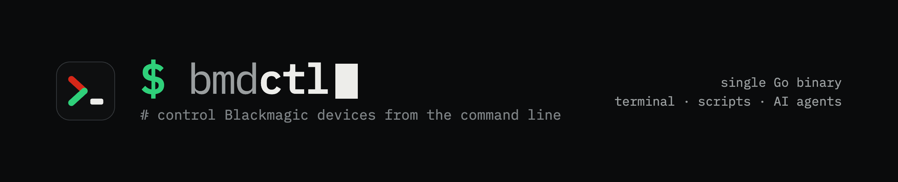

# bmdctl

[](https://github.com/lucas-romanenko/bmdctl/actions/workflows/ci.yml)
[](https://github.com/lucas-romanenko/bmdctl/releases/latest)

<!-- --8<-- [start:intro] -->
bmdctl is one binary that controls Blackmagic Design production equipment
over the network: ATEM switchers, HyperDeck recorders, Videohub routers
and Ultimatte keyers. It talks each device's own protocol (UDP 9910 to an
ATEM, TCP to the others), so no Blackmagic SDK, driver or ATEM Software
Control is involved. A background engine keeps a session open to each
switcher, deck and router, and every command is also served over HTTP and
to AI agents over MCP.

ATEM verified on hardware; HyperDeck, Videohub and Ultimatte ported, not
yet run on one.
<!-- --8<-- [end:intro] -->

<!-- --8<-- [start:sample] -->
```
$ bmdctl connect 192.168.1.20
STUDIO A  PGM CAM2 · PVW CAM1 · 1080p25 · connected 328 ms
  saved as "STUDIO A", now the default
$ bmdctl preview cam3
STUDIO A  PGM CAM2 · PVW CAM1
  preview     CAM1 → CAM3                                          27 ms
$ bmdctl cut
STUDIO A  PGM CAM2 · PVW CAM3
  cut         CAM3 on program · CAM2 on preview                    30 ms
$ bmdctl status
STUDIO A  1080p25 · session 14s, idle 3s, pinned

  ME 1        PGM  CAM3           PVW  CAM2
              mix 1:00 · next background · FTB off
```
<!-- --8<-- [end:sample] -->

## Install

macOS and Linux, into `~/.local/bin` (`/usr/local/bin` as root), checked
against the release's `checksums.txt`:

```sh
curl -fsSL https://raw.githubusercontent.com/lucas-romanenko/bmdctl/main/install.sh | sh
```

- **Windows** ([Scoop](https://scoop.sh)):
  `scoop install https://raw.githubusercontent.com/lucas-romanenko/bmdctl/main/scoop/bmdctl.json`
- **Debian, Ubuntu, Fedora:** the `.deb` or `.rpm` from the
  [latest release](https://github.com/lucas-romanenko/bmdctl/releases/latest)
  (`sudo apt install ./bmdctl_*_amd64.deb`), with the man page and
  completions.
- **Docker:** `ghcr.io/lucas-romanenko/bmdctl`, which runs the engine and
  the HTTP API (`docker run -d --network host -v bmdctl:/data ghcr.io/lucas-romanenko/bmdctl`).
- **Go 1.27:** `go install github.com/lucas-romanenko/bmdctl/cmd/bmdctl@latest`

The releases also install `atemctl`, `hdctl`, `vhctl` and `ultctl`:
bmdctl for one device (`hdctl play` is `bmdctl hyperdeck play`).
[docs/INSTALL.md](docs/INSTALL.md) covers PATH, completion, upgrading and
removal.

## Quick start

```sh
bmdctl connect 192.168.1.20   # asks what answers there, saves it by its own name
bmdctl status                 # program, preview, transition, keyers, aux
bmdctl program cam2           # a number, cam2, mp1, bars, or the input's name
```

## Why

- **Control over SSH.** Anything that can reach the switcher's network can
  run it from a shell: a jump host, a laptop on the VPN, a script. Nothing
  needs a desktop session or ATEM Software Control.
- **Switcher configs in git.** `bmdctl profile save show.xml` writes ATEM
  Software Control's XML and the media pool stills beside it. Commit them,
  and a change to a show's setup is a diff. (`profile restore` loads one
  back; parts of it have run on hardware, and docs/HARDWARE.md says which.)
- **AI agents over MCP.** `bmdctl mcp` gives Claude Code, Claude Desktop or
  any MCP client a tool per command group. Destructive commands do nothing
  until a person confirms. See [docs/AGENTS.md](docs/AGENTS.md).

Also:

- Scheduled changes: an `exec` cue file run from cron; every line is checked before the first is sent.
- Show control: call `bmdctl` from Companion's shell action, Node-RED's exec node or Home Assistant's `shell_command`.
- Tally: `bmdctl watch --json` prints each program, preview and tally change as one JSON line.
- Fleets: loop over `bmdctl hosts --json` and run the same command, or `profile save`, on every switcher.
- Teaching and CI: `--dry-run` prints a command's bytes with no switcher; the tests run against a fake switcher.
- A Raspberry Pi (64-bit OS) beside the switcher can run the engine and the HTTP API (`bmdctl engine --serve`).

## Documentation

The documentation is also a site, https://lucas-romanenko.github.io/bmdctl/
(built from `docs/` by `mkdocs.yml`).

- [docs/GUIDE.md](docs/GUIDE.md): a walkthrough, task by task, with
  what each command prints.
- [docs/COMMANDS.md](docs/COMMANDS.md): every command and flag, generated
  from the command table (`bmdctl man` prints the same).
- [docs/AGENTS.md](docs/AGENTS.md): the MCP server and the Claude skill.
- [docs/HARDWARE.md](docs/HARDWARE.md): what has run on real hardware (one
  ATEM so far; no deck, router or keyer yet) and what hasn't.
- [docs/ARCHITECTURE.md](docs/ARCHITECTURE.md): how the packages, the
  engine and the tests fit together.
- [CONTRIBUTING.md](CONTRIBUTING.md): building, testing and adding a
  command.

## Credits

- [bmdwire](https://github.com/lucas-romanenko/bmdwire), the Python
  original by the same author. bmdctl's device packages are a port of its
  libraries (atemwire, hyperdeckwire, videohubwire, ultimattewire),
  following v1.6.0.
- [pyatem](https://git.sr.ht/~martijnbraam/pyatem) by Martijn Braam and the
  OpenAtem contributors, for the ATEM protocol groundwork. atemwire, which
  `atem/` ports, is a fork of it ([atem/NOTICE](atem/NOTICE)).
- Skaarhoj and the ATEM community, for early protocol notes.

## Licence

bmdctl is MIT ([LICENSE](LICENSE)), except for two directories that are
LGPL-3.0-only: `atem/` ([atem/LICENSE](atem/LICENSE)), as atemwire, the
pyatem fork it ports, is, and `internal/fixtures/`, data copied from
atemwire's tests. [NOTICE](NOTICE) maps them.

Not affiliated with or endorsed by Blackmagic Design Pty Ltd. ATEM,
HyperDeck, Videohub and Ultimatte are trademarks of Blackmagic Design.
